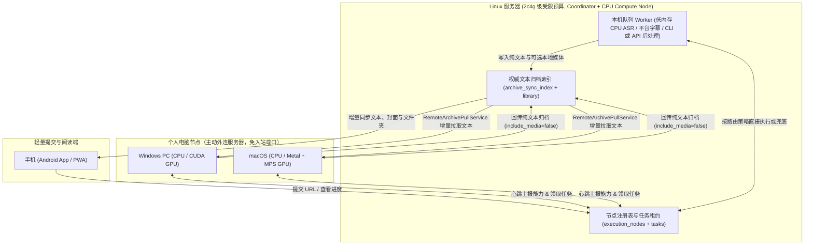

# 多设备协同与计算架构

本文说明 MediaProcessPipeline 在云服务器、多台个人电脑与手机之间分发任务、选择计算设备并同步结构化文本结果的设计契约，用于指导后续多端改造。

## 为什么现有实现未能跑通完整闭环

仓库目前已有 `app.core.remote_execution`、`services/remote_task_worker.py`、`services/remote_archive_upload.py` 与 `app.core.archive_sync`，仍有四项待实现：

1. **电脑端缺少拉取同步服务**。`RuntimeSettings` 定义了 `remote_sync_download_results: bool = True`，但后端没有任何消费者。目前只有电脑向服务器单向推送，以及 Android 原生插件单向拉取；另一台电脑无法自动拉取已完成归档。
2. **服务器只能绑定唯一一台远程电脑**。`remote_execution.py` 仅校验单一字符串 `remote_worker_id`，在线心跳只保存在进程内存变量 `_last_seen` 中，无法同时接入多台个人电脑，也无法按任务选择目标节点。
3. **本地推理阶段的设备选择不统一且存在 CUDA 默认值陷阱**。`uvr_device` 与 `local_llm_device` 默认值为 `"cuda"`，且 `diarization.py` 在 `pyannote_device` 为空时将 `sherpa_device="auto"` 直接映射为 `"cuda"`。在无 GPU 的 2c4g Linux 服务器或 macOS 上首次运行本地流程会直接报错，且前端缺少 Pyannote 与 ForcedAligner 的设备控件，也没有针对 Apple Silicon 展示 MPS 或 Metal。
4. **前端缺少多设备配置与节点状态界面**。12 个 `remote_sync_*` 与 `remote_execution_*` 配置项在设置页中均无入口，只能手动编辑 `config.json`。

## 节点角色与拓扑

系统采用“单中心协调库 + 多平等算力节点 + 多阅读端”的模型。除手机外，任何运行 FastAPI daemon 的设备都可以同时担任提交端、算力节点与本地归档阅读端。

各设备职责边界如下：

- **Linux 服务器（2c4g 级受限 cgroup，如 2 核配额、2 至 3 GiB 内存上限、无 Swap、磁盘余量有限）**：7×24 在线，持有权威任务状态与文本归档索引。它同时也是经过内存预算调优的 CPU 算力节点，可直接承担 URL 下载、平台字幕快路径、单槽位双线程 `llama.cpp` Qwen3-ASR 0.6B Q8 CPU 识别、小窗口（`uvr_mdx_segment_size=64`）CPU UVR 以及云端 API 或受并发限制的 OAuth CLI 后处理。
- **个人电脑（Windows 台式机如 `SilentField`、笔记本、macOS）**：开机运行 daemon 时主动轮询服务器 `/api/execution/poll`，上报自身节点 ID、平台和可用的 CPU/GPU 能力。平时作为主力重算力节点优先接单；离线重连后自动拉取服务器或其他电脑在离线期间产出的文本归档。
- **手机（Android App 与移动浏览器）**：只负责提交任务（可沿用默认执行节点或临时指定某台在线节点）、查看实时进度以及离线阅读同步下来的文本归档，不承担任何本地音视频推理，也不展示本地模型与 CPU/GPU 控件。

## 统一计算设备模型（非手机端全部可选 CPU 或 GPU）

除手机外，每一台计算设备上的全部本地推理组件都必须提供一致的运行设备选择，不允许在无 CUDA 机器上退回硬编码 `"cuda"`。

用户面统一采用三档语义 `auto | gpu | cpu`（同时向下兼容配置文件中已有的 `"cuda"`、`"mps"`、`"metal"` 字面量）：

| 推理模块 | 配置字段 | Windows / Linux (NVIDIA) | macOS (Apple Silicon) | 无独显机器（如 2c4g Linux） |
| --- | --- | --- | --- | --- |
| UVR 人声分离 | `uvr_device` | `gpu` 解析为 `cuda`，可选 `cpu` | `gpu` 解析为 CoreML/MPS（不支持时提示并可选 `cpu`） | `auto` 自动落到 `cpu` |
| llama.cpp ASR | `llama_asr_device` | `gpu` 解析为 `cuda`，可选 `cpu` | `gpu` 解析为 `metal`，可选 `cpu` | `auto` 自动落到 `cpu` |
| Sherpa ONNX ASR | `sherpa_device` | `gpu` 解析为 `cuda`，可选 `cpu` | 当前 ONNX 运行时使用 `cpu`（界面如实展示可用后端） | `auto` 自动落到 `cpu` |
| MOSS 一体化识别 | `moss_cpp_device` | `gpu` 解析为 `cuda`，可选 `cpu` | 按二进制支持解析为 `metal` 或 `cpu` | `auto` 自动落到 `cpu` |
| Qwen3 ForcedAligner | `aligner_device`（新增独立或跟随 ASR） | `gpu` 解析为 `cuda`，可选 `cpu` | `gpu` 解析为 `mps`，可选 `cpu` | `auto` 自动落到 `cpu` |
| Pyannote 说话人分离 | `pyannote_device` | `gpu` 解析为 `cuda`，可选 `cpu` | `gpu` 解析为 `mps`，可选 `cpu` | `auto` 自动落到 `cpu`（修复原空值误走 `cuda` 的问题） |
| 本地 LLM (`llama.cpp` / HF) | `local_llm_device` | `gpu` 解析为 `cuda`，可选 `cpu` | `gpu` 解析为 `metal` 或 `mps`，可选 `cpu` | `auto` 自动落到 `cpu` |

后端通过硬件探测函数统一报告本机实际可用的加速器（`cuda_available`、`mps_available`、`metal_available`、CPU 核心数与内存容量），暴露在系统能力接口中。前端模型设置页在桌面端与服务器网页上统一展示“自动 / GPU / CPU”选项，并在当前机器无可用 GPU 时标注实际回退设备；在手机端隐藏该区域。

## 核心领域模型

### 1. 算力节点注册表（`execution_nodes`）

替代原有的单一 `remote_worker_id` 字符串配置，服务器在 SQLite 中持久化已认证节点的状态：

- `node_id`：稳定节点标识（如 `SilentField`、`macbook-pro`、`local`）。服务器自身内置注册为 `local` 节点。
- `display_name`：界面可读名称。
- `platform`：`windows`、`macos` 或 `linux`。
- `compute_devices`：节点当前可用的推理后端列表（如 `["cpu", "cuda"]`、`["cpu", "mps", "metal"]`、`["cpu"]`）。
- `capabilities`：节点已就绪的能力集合（如 `ytdlp`、`uvr`、`asr_local`、`asr_api`、`diarization`、`llm_local`、`llm_api`）。
- `busy_count`、`max_concurrency`、`last_heartbeat_at`：供调度器判断节点在线与空闲状态。

### 2. 任务路由与离线策略

新建任务支持在 `options.execution` 中携带路由意图，未指定时继承服务器全局默认设置：

- `preferred_node_id`：优先执行节点 ID（如日常默认设为家里的主力机 `SilentField`，也可设为 `local` 直接由 2c4g Linux 服务器执行，或设为 `any` 交给任一空闲节点）。
- `offline_policy`：当优先节点离线或在 `remote_execution_wait_sec` 内未领单时的行为：
  - `wait`：保持排队等待优先节点上线，不转移执行权。适合依赖特定节点本地模型或专属登录态的任务。
  - `fallback_server`：超时后转入 2c4g Linux 服务器本机队列执行。适合服务器已配置好低内存 CPU 识别或云端 API 的日常任务。
  - `fallback_any_online`：超时后转交其他在线空闲电脑（如随身开启的 Mac），若均离线再决定等待或由服务器执行。

已领取任务的执行权继续采用单调随机租约 `attempt`（UUID）隔离。节点断线重连后凭匹配的 `node_id + attempt` 续传进度；任务若在服务器端被取消或改派新轮次，旧 `attempt` 的状态上报与结果导入一律返回 `409 Conflict` 拒绝，防止双写覆盖。

### 3. 默认纯文本同步契约

多设备之间的结果流转（包括远程算力节点向服务器回传，以及各台电脑与手机从服务器拉取）统一遵守“默认只同步结构化文本与轻量配图”的原则：

- **默认同步的文件集合**（与 `ArchiveSyncService._is_allowed` 完全一致）：
  - 根目录文本：`metadata.json`、`analysis.json`、`transcript.srt`、`transcript_polished.srt`、`transcript_polished.md`、`summary.md`、`mindmap.md` 及其他根级 `.json/.md/.srt/.txt` 产物。
  - 封面与配图：`cover.*`、`thumbnail.*`、`images/*`、`descriptions/*`。
- **默认排除的文件集合**：
  - 一切原始视频、原始音频、转码工作音频、UVR 分离轨道与识别切片（`.mp4`、`.mkv`、`.webm`、`.mp3`、`m4a`、`.wav`、`.flac` 等）。
- **跨端协同闭环流程**：
  1. 手机或轻薄本提交任务至 Linux 服务器。对上传的音视频文件，服务器使用 `tmp/staging/{staging_id}/` 暂存。旧版资料库使用 `_staging/{staging_id}/`。
  2. 目标执行节点（例如主力 PC，或服务器自身）拉取来源并完成识别与总结，在本机按 `media_retention_policy` 管理本机媒体文件。
  3. 远程电脑调用 `/api/sync/import` 回传 ZIP 时使用 `remote_sync_include_media`，默认值为 `False`。任务可以通过布尔值 `options.keep_server_media` 覆盖此设置。纯文本归档提交后，如果任务不要求保留媒体且没有其他任务引用暂存目录，服务器删除上传源文件。
  4. 开启了 `remote_sync_download_results=True` 的其他电脑通过新增后台服务 `RemoteArchivePullService` 轮询或监听 SSE 事件，按本地持久化的 `(server_url, workspace_id) -> cursor` 拉取增量变更、文件夹映射（`/api/sync/library`）与删除 tombstone，落入各自的本地 `archives/` 与 SQLite 索引。
  5. 阅读端打开无本地媒体文件的归档时，结果页直接呈现摘要、导图、润色文稿与时间轴字幕，并在播放器区域提供原视频链接（`metadata.source_url`）带时间戳跳转入口，不将“无本地媒体”视为异常状态。
